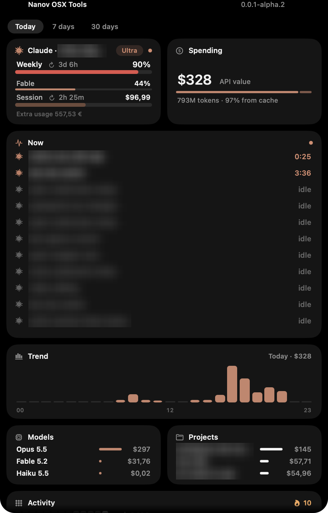
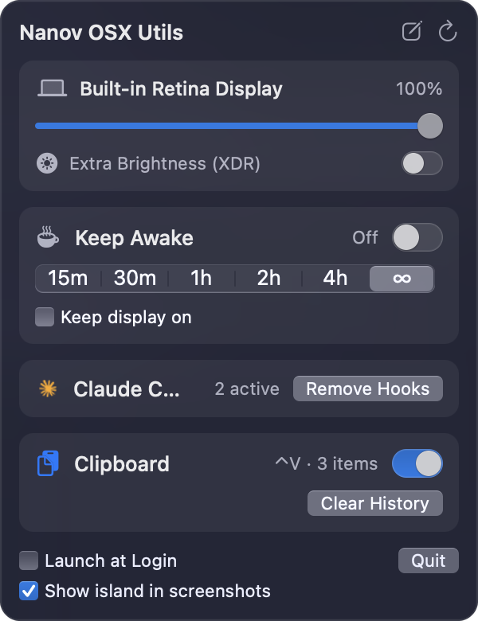
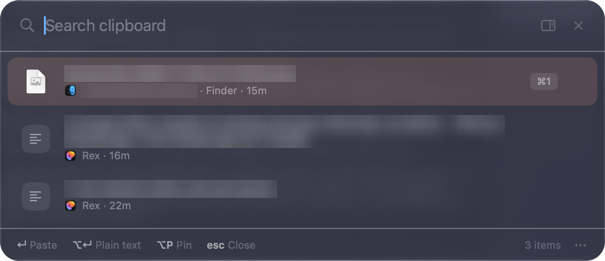

# Nanov OSX Tools

> **Experimental, and built for one person.** This is my personal menu-bar app, shaped around my Macs, my monitors and my habits. It works for me. It might work for you. It might also do something odd, and nobody is on call. Read the code before you trust it.

A small native macOS menu-bar app that replaced a Hammerspoon config and a handful of utilities I had running. It's plain AppKit, about 320 KB on disk, and sits at roughly 14 MB of memory when idle.

## What it does

- **Window and screen hotkeys.** Jump focus to the screen on the left, right, above or below. Throw the focused window onto another screen, keeping its proportions. The cursor comes along.
- **App hotkeys.** One shortcut per app: focus it, launch it, or open a window if it has none.
- **Keep awake.** Stop the Mac from sleeping, for a while or until you say so.
- **Brightness for every screen.** The built-in display, external monitors over DDC, and a software dimmer for monitors that won't take DDC (looking at you, docks).
- **Extra brightness.** On an XDR display the slider and keys keep going past 100%. There's no separate mode to think about.
- **Claude Code in the notch.** A small strip next to the notch (or a pill on screens without one) shows when a session is working, needs you, or has just finished. Hover it for a dashboard: plan limits, spend, trends, models, projects, and every open session. Click a session to jump to its pane in Rex.
- **Clipboard history.** Press ⌃V for the last 50 things you copied: search, pin, paste, or paste as plain text. Anything a password manager marks as secret is skipped, and nothing leaves the Mac.

<p align="center">
  
  
</p>
<p align="center"><sub>The notch dashboard and the menu-bar panel.</sub></p>

<p align="center">
  
</p>
<p align="center"><sub>Clipboard history, opened with ⌃V.</sub></p>

## Build

```sh
./scripts/build.sh          # → build/Nanov OSX Utils.app
```

The Command Line Tools are enough; you don't need Xcode. The app needs Accessibility access for the hotkeys and windows.

macOS forgets that access every time an ad-hoc signed build changes. Run `./scripts/make-signing-cert.sh` once to create a local signing certificate, and the build script will use it from then on.

## Config

Shortcuts live in `~/.config/osx-utils/config.json`. The app writes the defaults on first launch and picks up your edits as you save.

```json
{
  "bindings": [
    { "keys": "ctrl+cmd+right",     "action": "focusScreen",        "direction": "right" },
    { "keys": "ctrl+alt+cmd+right", "action": "moveWindowToScreen", "direction": "right" },
    { "keys": "ctrl+cmd+t",         "action": "focusApp", "app": "com.mitchellh.ghostty" },
    { "keys": "ctrl+alt+cmd+k",     "action": "toggleKeepAwake", "minutes": 60 }
  ]
}
```

| Action | What it does |
|---|---|
| `focusScreen` | Focuses the front window on the neighbouring screen (`left`, `right`, `up`, `down`). |
| `moveWindowToScreen` | Moves the focused window to the neighbouring screen and scales it to fit. |
| `focusApp` | Focuses the app with this bundle id, launching it if needed. |
| `toggleKeepAwake` | Keeps the Mac awake; `minutes` is optional. |
| `clipboardHistory` | Opens clipboard history (default `ctrl+v`). |
| `pastePlain` | Pastes the clipboard as plain text (default `shift+alt+cmd+v`). |

Modifiers are `cmd`, `ctrl`, `alt` (or `opt`) and `shift`. Keys follow physical positions, so a shortcut stays put whatever your keyboard layout. If a shortcut is broken or another app already owns it, the menu-bar panel tells you.

Everything else (brightness, extra brightness, keep awake, clipboard, Claude Code hooks) is switched on and off from the menu-bar panel. The Claude Code card there installs and removes the hooks; they live in `~/.claude/settings.json`, and the app backs that file up before it touches it.

## License

[WTFPL](LICENSE): do what you want with it.
